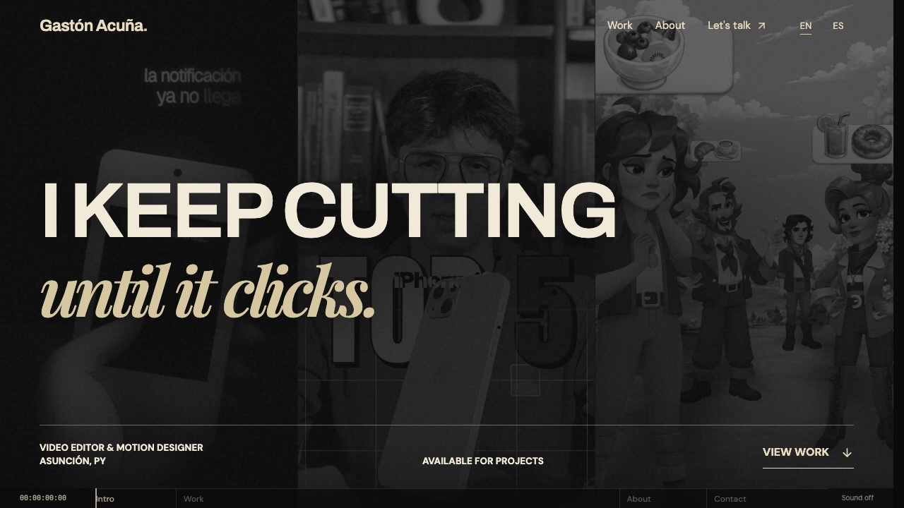
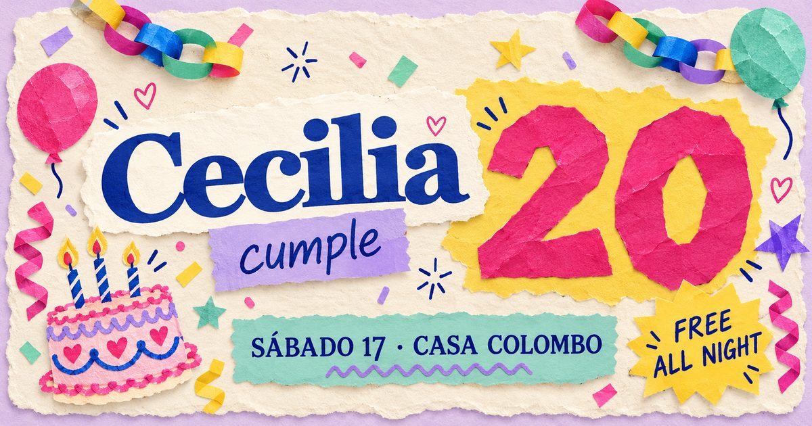
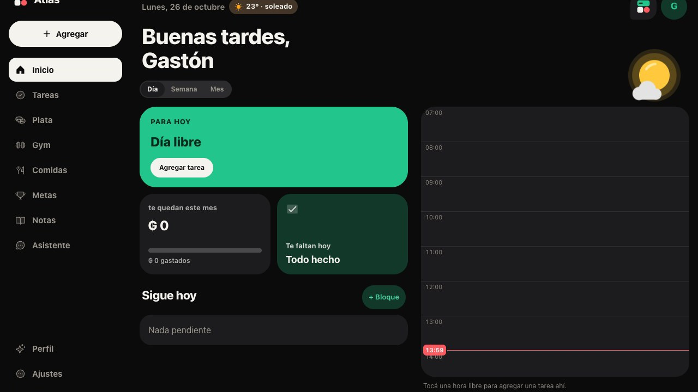

# hey, i'm gastón

I make websites, edit videos, and work with motion graphics. Based in Paraguay.

Most of my web work uses React, TypeScript and CSS. I also use Canvas and SVG for animation.

For video editing and motion graphics, I use Adobe Creative Cloud, mainly Premiere Pro and After Effects.

[LinkedIn](https://www.linkedin.com/in/gast%C3%B3n-acu%C3%B1a-9b065735b/)

### A few things I've made

<table>
<tr>
<td width="50%" valign="top">

<a href="https://gaston.mov"><strong>Video portfolio</strong></a> A dark, full-screen hero and editorial work gallery. Built with React, Motion and Lenis.

<a href="https://gaston.mov">Live site</a> · <a href="https://github.com/GastonAcuna12/EditingPortafolio">Code</a>
</td>
<td width="50%" valign="top">

<strong>Birthday invites</strong> Paper scraps, cutouts and stop-motion-style animation, made for the web.

<a href="https://ceci20.party/">Cecilia</a> · <a href="https://thais16.online/">Thais</a>
</td>
</tr>
<tr>
<td width="50%" valign="top">

<strong>Andrea Brítez</strong> A website for a clinical psychologist. Plain HTML, CSS and JavaScript.

<a href="https://dra-andrea-britez.vercel.app/">Live site</a> · <a href="https://github.com/GastonAcuna12/andrea-britez-portafolio">Code</a>
</td>
<td width="50%" valign="top">

<strong>Atlas</strong> A personal app for the day, money and gym. Runs on Mac and iPhone. Built with Next.js and Capacitor.

Private project
</td>
</tr>
</table>
